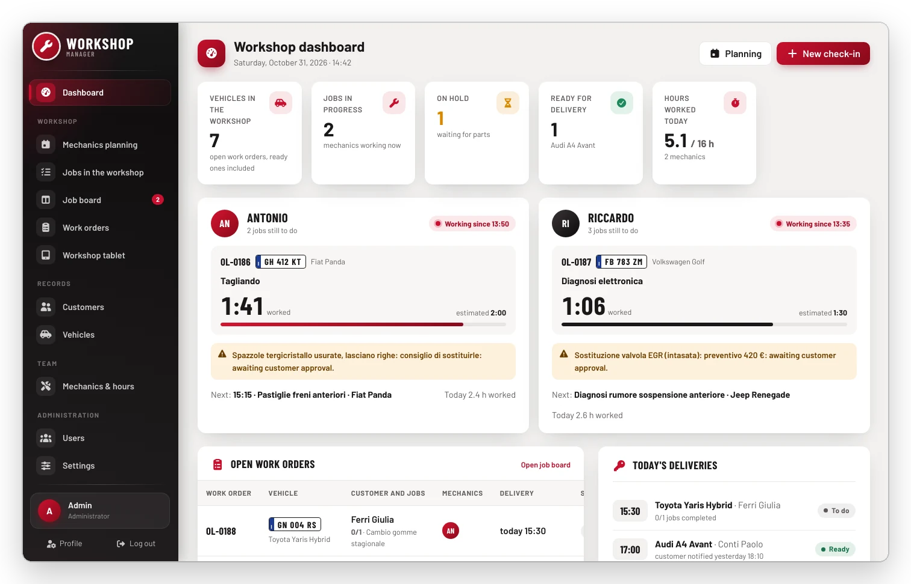
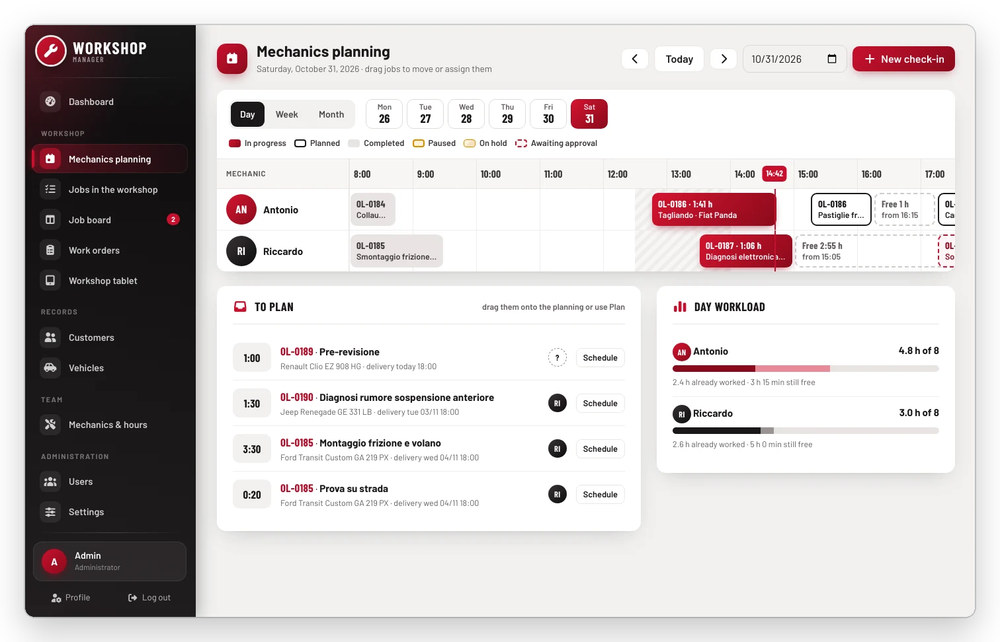
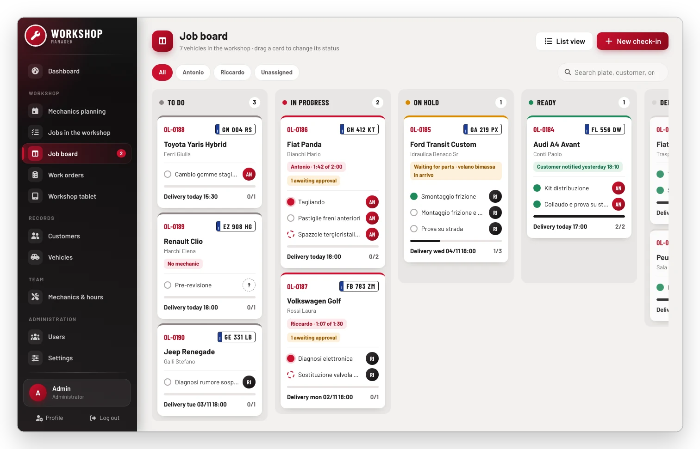
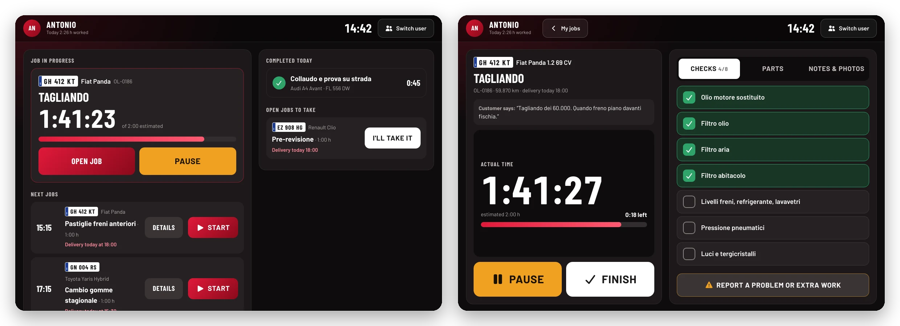
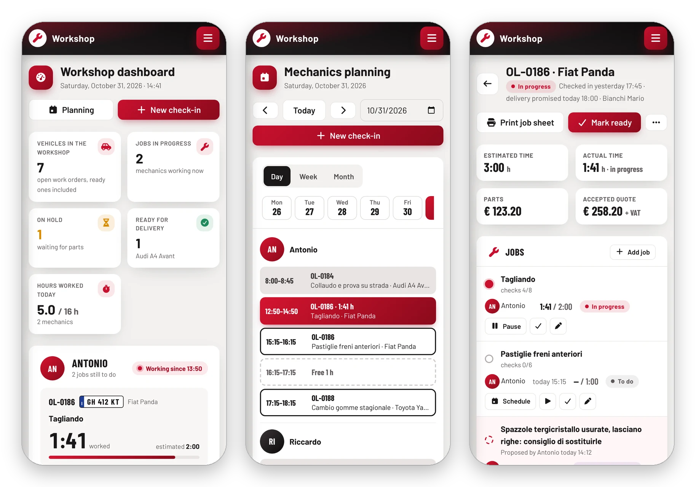
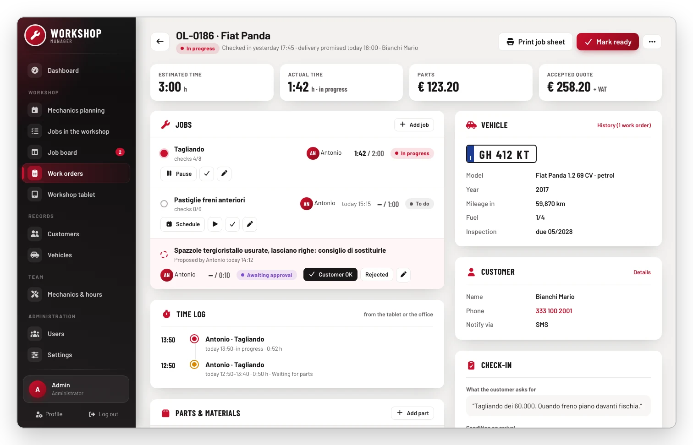
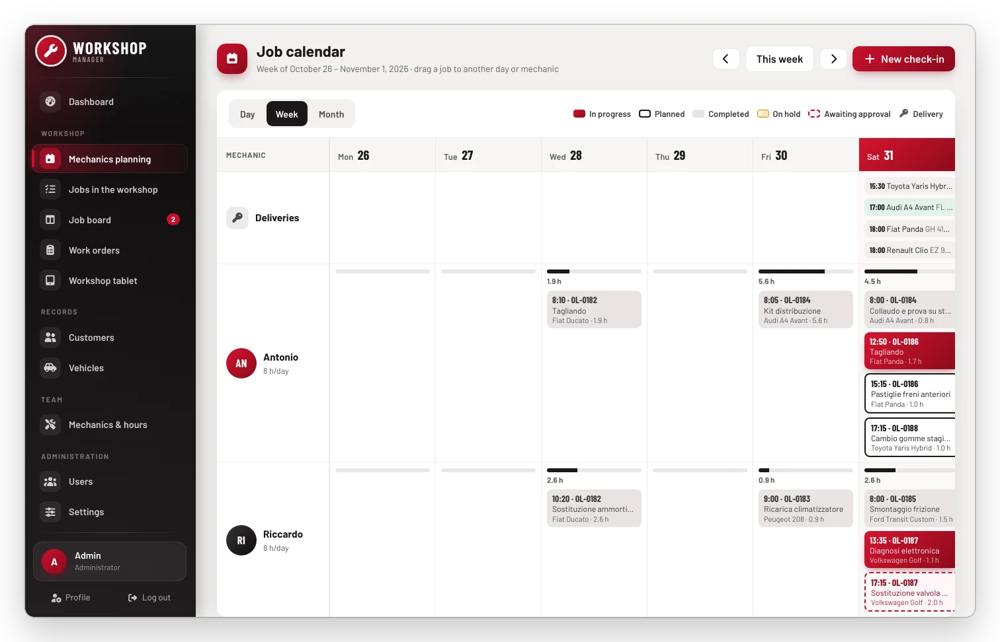

<h1 align="center">Workshop Manager</h1>

<p align="center">
  A web app to run a car-repair workshop: work orders, mechanics' planning, a job board, and a tablet on the
  shop floor where mechanics clock their time.
</p>

<p align="center">
  
  
  
  
  
</p>

<p align="center">
  
</p>

Who is working on what, how long is left, which car is waiting for parts or for the customer's approval: the
whole workshop at a glance, with real times taken from the tablet. The interface speaks English, Italian,
Spanish, German and French.

## Features

- **Dashboard** — vehicles in the workshop, what every mechanic is doing right now (timer, estimate, next job),
  today's deliveries, things to deal with (customer approvals, delays, unassigned jobs, parts to order or on
  their way), hours worked this week.
- **Planning** — the day in quarter hours per mechanic, lunch break, "now" line, free slots and jobs still to
  plan; drag to change time and mechanic. **Week** view (mechanics × days with load and deliveries, draggable)
  and **month** view (hours per mechanic and deliveries of each day).
- **Job board** — columns To do / In progress / On hold / Ready / Delivered; drag a card to change its status
  (moving it to "On hold" asks for the reason). Filter by mechanic and search.
- **Work orders** — check-in (vehicle and customer from the records or created on the fly, job templates to
  tick), order page with jobs, time log, parts and totals, photos, history, and a printable job sheet with the
  workshop's name.
- **Workshop tablet** (`/tablet`) — mechanics tap their name (optional PIN), see the job in progress, the next
  ones and open jobs; start, pause with a reason, finish; tick checks, record parts (also "missing: to order"),
  mileage, notes and photos; report extra work or safety issues, which the office approves or rejects.
- **Customers**, **Vehicles** (with service history), **Mechanics & hours** (hours per day, estimated vs. actual),
  **Users**, **Settings** (workshop name, opening hours, lunch break, labour rate, job templates).
- **Five languages** — English, Italian, Spanish, German, French: from the browser or chosen in the Profile;
  dates and numbers follow the language. Works on phones too (agendas instead of grids).

## Screenshots

<p align="center">
  
</p>

<p align="center">
  
</p>

**Workshop tablet**

<p align="center">
  
</p>

**On the phone**

<p align="center">
  
</p>

<details>
<summary>Work order and week calendar</summary>
<br>
<p align="center">
  
  
</p>
</details>

<sub>Screenshots show the English interface with the sample data from `app:demo` (created in Italian).</sub>

## Try it locally

You need Docker. Web on <http://localhost:20036>, MariaDB on `localhost:30036`.

```sh
cp .env.example .env                    # set DB_PASSWORD
./start_stack.sh                        # build + start
docker compose exec -w /app web composer install
docker compose exec -w /app web yarn install
./yarn_encore_dev.sh                    # assets (or yarn_encore_dev_watch.sh)
docker compose exec -u application -w /app web php bin/console doctrine:migrations:migrate -n
docker compose exec -u application -w /app web php bin/console app:setup --password=<pwd>
docker compose exec -u application -w /app web php bin/console app:demo      # optional sample data
```

- Run the console as `application` (`-u application`): as root the cache becomes unreadable for Apache.
- `app:setup` is idempotent: roles, the `admin` user and, only when the tables are empty, job templates
  (service, brake pads, tyres, pre-inspection…) and two mechanics.
- `app:demo` loads a workshop morning with times relative to now, plus the users `ufficio` (office) and
  `officina` (tablet), password `demo`. `--reset` deletes work orders, vehicles and customers: **never on real data**.

## Production

Portainer stack from Git with `docker-compose.prod.yml` and a Cloudflare tunnel (service `http://web:80`).
Variables are listed in `.env.example`; on start-up `docker/entrypoint.d/60-officina.sh` runs the migrations and
`app:setup`. Volumes to back up: `db_data` and `uploads` (photos and documents).

## How it works

- A mechanic works on one thing at a time: starting another job pauses the current one ("Switched to another job").
- The first job started moves the work order to "In progress"; a pause for parts or for the customer's approval,
  with nothing else running, moves it to "On hold".
- When every job is completed the order becomes "Ready"; if there is extra work the customer hasn't answered
  yet, it stays "On hold · customer approval".
- Reports from the tablet are "awaiting approval" jobs: they don't count for progress and totals until the
  office approves them.
- Actual time is the sum of the time entries (`TimeEntry`), one per start/resume. Times live on the server, so
  the tablet can go back to the mechanic picker (it does so by itself after 3 idle minutes) without stopping
  the timer.
- **Languages**: the Italian sentence is the translation key (`{{ 'Nuovo ordine'|trans }}`), translations live in
  `app/translations/*.{en,es,de,fr}.json`. The language comes from `user.locale` (Profile) or the browser
  (`LocaleSubscriber`); dates use ICU patterns in the current language (`App\Service\Dates`), numbers the
  separators from `App\Service\Language`, scripts get their strings from `templates/_js_strings.html.twig`
  through `assets/js/i18n.js`. Data typed by users (customers, vehicles, job names, notes) is never translated;
  the history log is stored in Italian and translated when shown.

## Roles

| Role | Can |
|---|---|
| Administrator | everything, plus users and settings |
| Office | check-in, work orders, planning, job board, customers, vehicles, mechanics; can open the tablet too |
| Workshop tablet | only the tablet: the user the shop-floor tablet signs in with |

## Tech

Symfony 8.1 + Doctrine, MariaDB 11, Twig + Bootstrap 5 built with Webpack Encore, Chart.js, DataTables;
container `webdevops/php-apache:8.4`.
